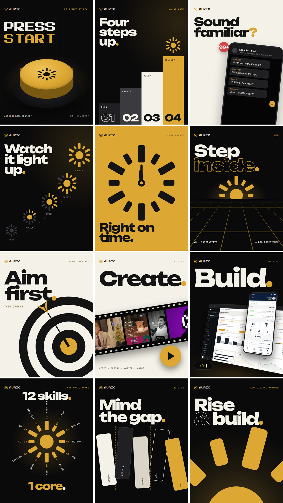

# AURIC — Social media identity and launch campaign

The social presence for the evolved AURIC: an integrated digital partner. It is designed as an extension of the website (`auric404.me`, this repository).



## Read in this order

1. [AURIC_BRAND_ANALYSIS.md](AURIC_BRAND_ANALYSIS.md): what was inspected, the positioning, the gaps (including Experience/VR), and which assets can and cannot be used.
2. [AURIC_SOCIAL_VISUAL_GUIDELINES.md](AURIC_SOCIAL_VISUAL_GUIDELINES.md): colour, type, logo, layout, the visual system, image and motion direction, and do/avoid. Every value is cited from the site source.
3. [AURIC_SOCIAL_STRATEGY.md](AURIC_SOCIAL_STRATEGY.md): the central idea, voice, the six pillars, the 12 formats, the campaign logic, checks to clear before publishing, and measurement.
4. [AURIC_CAPTIONS.md](AURIC_CAPTIONS.md): every caption, CTA, alt text and LinkedIn post, ready to paste.
5. [AURIC_CONTENT_CALENDAR.md](AURIC_CONTENT_CALENDAR.md): four weeks, 22 Nov – 17 Dec 2026, Instagram and LinkedIn.
6. `posts/<NN>/caption.md`: the full brief and copy for each post.

## Campaign overview: "One partner."

The AURIC mark is a sun with **12 rays around one core**. The campaign uses it as the explanation of the offer:

- **The rays** are the disciplines a project can need.
- **The core** is the one team, and the one person, who holds them together.

The 12 posts run in four acts:

| Act | Posts | Logic |
|---|---|---|
| I. The idea | 01 Introducing · 02 The gap · 03 Twelve rays, one core | Recognisable first (the website hero), then the problem, then the model in one image |
| II. The capabilities | 04 Build · 05 Create · 06 Four questions | Proof before claims: real shipped products and real films; strategy shown by teaching, not selling |
| III. The rest of the sun | 07 Experience · 08 Manage · 09 One project | The newest pillar as a concept; management as a promise; all of it connected, with the sun filling up |
| IV. Working together | 10 Sound familiar? · 11 How we work · 12 Let's make it real | The client's problems, the process and what you get, then the invitation |

The capabilities are deliberately not posted as five ads in a row. Each one does a different job: proof, teaching, concept or statement.

## Deliverables (v2: visual posters)

The posters carry the idea in one image and a few words. The message lives in the captions (`caption.md`).

| Post | Poster | Slides | Exports |
|---|---|---|---|
| 01 | **Rise & build.** A giant AURIC sun rising from the bottom edge | 1 | `slide-01.png`, `story.png`, `linkedin.png` |
| 02 | **Mind the gap. / We close it.** Scattered blocks, then snapped into one bar | 2 | `slide-01…02.png`, `carousel.pdf` |
| 03 | **12 skills. 1 core.** One word on each ray of the sun | 1 | `slide-01.png`, `linkedin.png` |
| 04 | **Build.** Real screens floating in 3D, each project's name in giant outline | 4 | `slide-01…04.png`, `carousel.pdf` |
| 05 | **Create.** A film strip of real client work, plus a play button | 4 | `slide-01…04.png`, `carousel.pdf` |
| 06 | **Aim first.** A dartboard with a bullseye | 1 | `slide-01.png` |
| 07 | **Step inside.** A grid floor with the sun on the horizon *(blocked until VR is confirmed)* | 1 | `slide-01.png` |
| 08 | **Right on time.** The 12 rays as a clock face | 1 | `slide-01.png` |
| 09 | **Watch it light up.** Five suns lighting up along an arc | 1 | `slide-01.png` |
| 10 | **Sound familiar?** The chaotic launch group chat, 99+ | 1 | `slide-01.png` |
| 11 | **Four steps up.** The process as a staircase, with the sun on top | 1 | `slide-01.png` |
| 12 | **PRESS START.** An arcade button with the sun on it | 1 | `slide-01.png`, `story.png` |

Totals: 19 feed images at 1080 × 1350, 2 Stories, 2 LinkedIn images, and 3 carousel PDFs. Ready-to-post copies are in
`final-posts/` (one folder per post, with images and caption). The first, text-heavy version (v1) is in the git history
(commit `4d5c8f5`).

## Structure

```
auric-social-media/
  README.md                         this file
  AURIC_BRAND_ANALYSIS.md
  AURIC_SOCIAL_VISUAL_GUIDELINES.md
  AURIC_SOCIAL_STRATEGY.md
  AURIC_CONTENT_CALENDAR.md
  feed-preview.png                  the 12 covers as the profile grid shows them (3:4 crop)
  assets/
    brand.css                       the design system: tokens, type, logo, pills, frames, rows, textures
    brand.js                        components: logo lockup, sun mark (with progress lighting), hero pills, export mode
    fonts/                          the website's own font files (Unbounded, Geist, Geist Mono, Press Start 2P, Alexandria, IBM Plex Sans Arabic)
    logo/                           lockups and mark (PNG), app icon (SVG), logo-sheet.html source
    work/                           real AURIC work used in the posts (copied from public/work)
    reference/                      the website's share image
  posts/NN-name/
    post.html                       editable source, one <section class="slide"> per slide
    extras.html                     Story / LinkedIn sizes (where present)
    caption.md                      concept, copy, caption, CTA, hashtags, design, execution, motion
    export/                         final PNGs (+ carousel.pdf)
  tools/
    render.mjs                      exports everything with headless Chrome
    feed-preview.mjs                builds feed-preview.png
```

## Editing and re-exporting

The posts are plain HTML and CSS built on the website's tokens.

1. Edit the text in `post.html`.
2. Open the file in Chrome to preview all slides. Add `?s=3` to the URL to see slide 3 at its real size.
3. Re-export from the repository root:

```bash
node auric-social-media/tools/render.mjs
```

```bash
node auric-social-media/tools/render.mjs 04 logo
```

```bash
node auric-social-media/tools/feed-preview.mjs
```

The second command re-exports only post 04 and the logos. The renderer needs Google Chrome; set `CHROME_PATH` if it isn't in the default location. `feed-preview.mjs` uses `sharp`, which is already a dev dependency of the site.

**Changing the system:** a change to a colour, size or component in `assets/brand.css` or `brand.js` reaches every post on the next render.

## Art director review (Phase 7)

Every slide was rendered, looked at, and revised where it failed. What was checked, and what changed:

| Check | Result |
|---|---|
| **Matches the website** | Same tokens, fonts (the site's own font files), logo geometry, gold full stop, mono labels, pills, frames, calendar grid, numerals and grid texture. Post 01 is the site hero itself. |
| **Logo** | Rendered from the `Logo.tsx` geometry. It is never redrawn or distorted, and the wordmark is always Press Start 2P with the gold U. |
| **Text load (v2)** | Each poster has one headline of five words at most, plus at most one short label. Everything else moved into the caption. |
| **Readability** | Labels are 20px or more on a 1080 canvas. Text over photos sits on a solid gradient (this also hides the TCG still's burned-in subtitle). |
| **Composition** | Fixed during review: |
| | an overflowing pill on 01 |
| | a split full stop on 01 |
| | the sun overlapping copy on 07 (sun moved below the horizon line) |
| | a colliding column label on 03 |
| | empty lower halves on 02/1, 09 and 10 (type enlarged) |
| | a headline wrapping on 08 |
| | the "Create." cover cut off at the 3:4 grid crop |
| **Outline type** | The variable font's overlapping contours showed inside outlined letters. Fixed for every post in `brand.css` (`paint-order: stroke fill`). |
| **Honesty** | Every work image is labelled with its real status (client project, AURIC product, showcase build, client work). Post 09 is marked "Illustrative example". No statistics, client quotes or invented clients. Experience shows no portfolio and is blocked until confirmed. |
| **Copy** | Plain and specific, with no banned agency phrases. Captions add context instead of repeating the slide. |
| **Campaign** | Four acts, three posts per act. The feed alternates dark, cream and gold (see `feed-preview.png`), and no two formats share a layout. |

## Not done yet (needs AURIC)

- **Post 07:** confirm the Experience/VR capability. Otherwise use the backup post described in the strategy.
- **Post 03:** confirm the founder is happy with the 12-rays reading of the mark.
- **Arabic:** captions and, optionally, Arabic slide versions need a native copywriter. Draft lines are in each `caption.md`.
- **Previous feed:** the existing Instagram and LinkedIn posts were not reviewed. Decide whether to archive them before launch.
- **Motion versions:** the Reels are specified in each `caption.md` but have not been produced. They can be built from the same HTML with the site's motion values.
